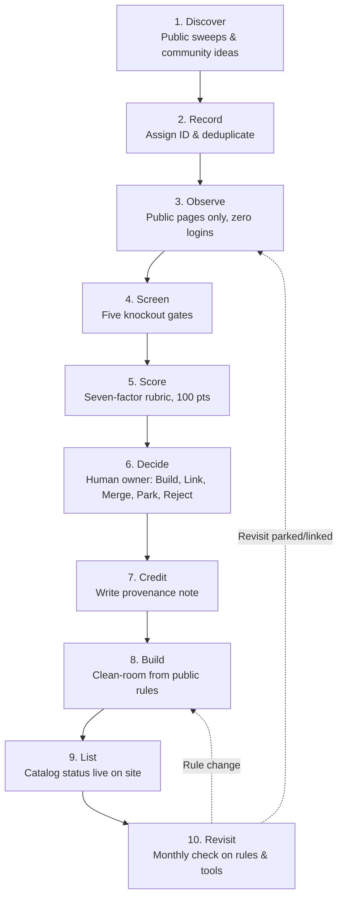
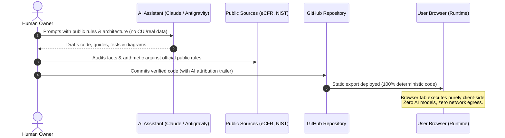

<p align="center">
  <picture>
    <source media="(prefers-color-scheme: dark)" srcset="public/brand/logo-dark.svg">
    
  </picture>
</p>

<p align="center">
  <strong>Free, open-source tools for the paperwork between you and a government contract.</strong><br>
  <em>Empowering cleared engineers and independent builders to bid, win, and own their labor directly.</em><br>
  <a href="https://clearedstack.com">clearedstack.com</a>
</p>

---

In defense contracting, **corporations do not write code or secure networks—individual engineers, technicians, and craftsmen do.** Yet traditional multi-billion-dollar prime contractors capture the vast majority of contract value simply by managing compliance red tape and administrative moats, while the person doing the work receives a fraction of their billing rate.

**ClearedStack** is a free, open-source toolbox that automates the paperwork barriers—pricing, proposals, cyber compliance, and market research. We give these tools away so that solo developers, veteran founders, and independent teams can bid directly, outcompete legacy contractor bloat, and bring workplace autonomy to the defense industrial base.

This repository is the **website**: the open public hub at clearedstack.com that explains the project and indexes the tools. Each tool is an independent open-source project designed to run 100% in your browser.

## The Core Thesis: Builders Over Bloat

Selling to the Department of Defense takes more than technical excellence. Before an independent company can bid, it has to price labor under FAR Part 31, construct indirect rates an auditor will accept, answer every instruction of Sections L and M, and prove CUI protection under NIST SP 800-171 and CMMC. 

Large contractors maintain entire departments for this. A solo builder has evenings.

Almost all of that knowledge is public. It sits in statutes, regulations, and agency guides. What costs money is turning it into a worked answer for one company's situation, and that step is mostly arithmetic, lookup tables, and checklists.

- **The Tollbooth Model:** Legacy primes act as administrative tollbooths on cleared human labor. The government pays $300+/hour for an engineer, the engineer takes home a fraction of that wage, and the remaining 60%+ is absorbed by executive bonuses, K Street lobbyists, and non-technical management layers.
- **Democratizing the Workplace:** ClearedStack turns the compliance barrier into free software. When the regulatory overhead is automated, the individual worker can bid, win, and keep the full fruit of their labor. The taxpayer pays less, the warfighter gets better software, and the builder owns their work.

## Ground rules

| | |
| --- | --- |
| **Free** | No paywall, ads, subscriptions, sponsorships or donations. The project takes in no revenue. |
| **Open source** | MIT licensed. Read the code, check the math, fork it, host it yourself. |
| **Client-side** | Tools run entirely in your browser. Your rates, proposal text, and system details never leave your machine. |
| **No tracking** | No analytics, cookies or accounts. The site makes no third-party requests and enforces that with a content security policy. |
| **Air-gapped ready** | Designed for disconnected environments. Tools can be cloned, bundled, and run on isolated networks with zero external calls. |
| **Public sources only** | Built only from material the government has officially released to the public. Nothing classified, controlled or non-public. |
| **Independent** | An independent personal project with no government affiliation. See the [disclaimer](#disclaimer). |

## The catalog

Eighteen tools are planned across five areas. None are live yet; each will be
linked from the site the day it works.

| Area | Tools |
| --- | --- |
| **Pricing & cost accounting** | Wrap Rate Calculator · Indirect Rate Estimator · Section B Pricing Table Builder · Prompt Payment Interest Tracker |
| **Proposal & capture** | RFP Requirement Shredder · Compliance Matrix Generator · Acronym Table Builder · Page Budget Planner |
| **Cybersecurity & compliance** | NIST SP 800-171 / CMMC Readiness Checklist · CUI Marking Generator · DISA STIG Reference Lookup · OSCAL Validator |
| **Market research & small business** | NAICS-to-PSC Crosswalk · NDC Eligibility Checker · Small Business Set-Aside Guide |
| **Tactical & DevSecOps** | Offline Manifest Inspector · Certificate Verifier · Air-Gap Transfer Helpers |

The list on the site is generated from [`src/data/catalog.ts`](src/data/catalog.ts).

## Roadmap

1. **The free arsenal.** Ship the core catalog one client-side tool at a time until every small contractor keeps this page open all day.
2. **The community.** Open the catalog to tools and scripts written by other cleared engineers, veterans, and small builders who do this work for a living.
3. **The sovereign alternative.** Grow that community into a decentralized, democratic platform where independent builders swarm on defense contracts directly, cutting out corporate middle management.

## How tools are chosen (Prior Art — draft)

ClearedStack uses a ten-stage process called Prior Art to decide what to build. It looks at paperwork tools that already exist across government contracting, observes what they do from their public pages without logging in, screens and scores candidate ideas openly, lets the human owner make the decision, and credits where every idea came from. Approved tools are then built from the public regulation from scratch, never from another tool's code, text or design.

> **Draft / intent only**: This process is currently intent and in draft. The automated engine is not running, no separate repository (`ClearedStack/prior-art`) exists yet, and nothing has been collected. The full evaluation factors and scoring rubric are described at [https://clearedstack.com/how-we-decide/](https://clearedstack.com/how-we-decide/).



## How this project is built

This project is built with AI assistance (Claude Code and Antigravity) under a single human owner who sets direction, makes every decision, reviews every change, and remains accountable.

- **Human accountability**: The human owner makes every technical and design decision. Every regulatory statement and calculation is checked by a person against primary public sources before shipping. AI output is never the source of a rule.
- **Strict data boundaries**: Prompts never contain non-public information, Controlled Unclassified Information (CUI), real contract data, real company rates, or personal information. All examples are made up.
- **Authoring vs. runtime**: AI assistance is used only to **author and build** the site and tools. The tools themselves run entirely in the user's browser, contain zero AI models, and make zero network calls at runtime.
- **Commit attribution**: Commits made with AI help carry a git trailer naming the tool (`Assisted-by: Claude Code` or `Assisted-by: Antigravity`), and decision records identify which tool drafted candidate scores.



## Working on the site

The site is [Next.js](https://nextjs.org) with TypeScript and Tailwind CSS,
exported as static files. It has no server, no API routes and no database.

```bash
npm install
npm run dev        # http://localhost:3000
npm run lint
npm run typecheck
npm run build      # writes the static site to out/
npm run preview    # serves out/ locally
```

Requires Node.js 20 or newer. The contents of `out/` can be hosted on any
static file host.

```
src/
  app/            pages: home, /tools, /guides, /about, plus icons and metadata
  components/     header, footer, logo, catalog list, guides list
  data/
    catalog.ts    the categories and tools shown on the site
    site.ts       name, URLs, contact address, short disclaimer
  guides/         one .mdx file per guide
  lib/guides.ts   the guide sections, and the code that reads and orders the guides
public/brand/     logo files (SVG, light and dark)
Containerfile   builds the site and serves it with nginx (rootless BuildKit, zero Docker)
k8s/              Kubernetes manifests: deployment, service, example ingress
```

### Hosting on Kubernetes (No Docker)

ClearedStack runs on `k3s` + `containerd` with **zero Docker**: Go services are built with `ko`, and the web portal is built from [`Containerfile`](Containerfile) using rootless BuildKit and stored in `cs-registry`.

```bash
kubectl apply -f k8s/clearedstack.yaml
```

The manifest creates a namespace, a two-replica deployment and a service.
The pods run non-root with a read-only filesystem and no added privileges.
See [One-Command Quickstart](src/guides/one-command-quickstart.mdx), [Host on Kubernetes (No Docker)](src/guides/host-on-kubernetes.mdx), [Host as plain files](src/guides/host-static-files.mdx), and [Run it on a closed network](src/guides/closed-networks.mdx).

### Listing a tool

Add an entry to `tools` in [`src/data/catalog.ts`](src/data/catalog.ts):

```ts
{
  slug: "wrap-rate-calculator",
  name: "Wrap Rate Calculator",
  summary: "Build a fully burdened labor rate from base pay, fringe, overhead, G&A and fee.",
  category: "pricing",
  status: "live",            // "planned" | "building" | "live"
  url: "https://…",          // where it runs
  repo: "https://github.com/ClearedStack/…",
  provenance: {              // optional: where the idea came from and clean-room notes
    inspiredBy: [
      { name: "Tool A", kind: "commercial", url: "https://…", observed: "2026-11" },
    ],
    note: "Built from FAR Part 31 from scratch; runs in the browser.",
  },
},
```

The home page, the catalog page and their counts update from that one entry.
See [CONTRIBUTING.md](CONTRIBUTING.md) for what a tool needs before it is listed.

### Adding a guide

The [guides](https://clearedstack.com/guides/) explain how to use the site,
give plain-language background on the subjects the tools cover, and show how
to host a copy. Each one is a file in [`src/guides/`](src/guides); the file
name becomes the URL. Start the file with its details, then write the guide in
Markdown:

```mdx
export const meta = {
  title: "Getting started",
  summary: "One sentence shown in the list and under the title.",
  group: "start",        // "start" | "field" | "host" | "contribute" | "reference"
  order: 1,              // position within its section
  reviewed: "2026-11",   // optional: month the facts were last checked
};

Your first paragraph.

## A heading
```

The guides page, the table of contents on each guide, the reading time, the
previous/next links and the sitemap pick it up on the next build. Tables work,
and `<Callout kind="note | check | warning">` sets a short passage apart.
[Work on this site](src/guides/work-on-this-site.mdx) has the details.

Guides that describe regulations set `reviewed` and end with a "Sources"
section. Check each fact against the official text before you write it down.

## Brand

| File | Use |
| --- | --- |
| [`public/brand/logo-light.svg`](public/brand/logo-light.svg) | Full logo on light backgrounds |
| [`public/brand/logo-dark.svg`](public/brand/logo-dark.svg) | Full logo on dark backgrounds |
| [`public/brand/mark-light.svg`](public/brand/mark-light.svg), [`mark-dark.svg`](public/brand/mark-dark.svg) | The mark alone |

Colors: ink `#121714`, paper `#F5F4EF`, green `#17794A` (on light) and
`#4FD08C` (on dark). Type: IBM Plex Sans and IBM Plex Mono, self-hosted.

## Disclaimer

ClearedStack is an independent personal project, built on personal time with
personal equipment. It is not affiliated with, endorsed by, or sponsored by
the U.S. Department of Defense, any military service or any other government
agency. The views expressed are the maintainers' own. They do not represent
the views of the Department of Defense or its components, or an official
position of the U.S. Government.

The name does not grant, verify or imply a security clearance, an
authorization to operate, or any certification.

The tools are aids for your own work. They are not legal, accounting, tax or
compliance advice, and they can be wrong or out of date. Check results against
the current text of the governing regulation before you rely on them.

## License

[MIT](LICENSE). Contact: [contact@clearedstack.com](mailto:contact@clearedstack.com)
