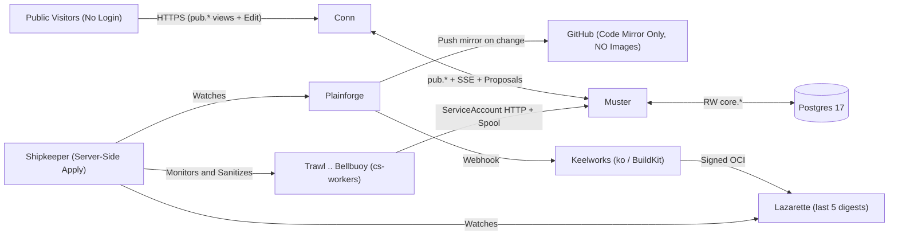

<p align="center">
  <picture>
    <source media="(prefers-color-scheme: dark)" srcset="public/brand/logo-dark.svg">
    
  </picture>
</p>

<p align="center">
  <strong>Free, open-source tools for the paperwork between you and a government contract.</strong><br>
  <a href="https://clearedstack.com">clearedstack.com</a>
</p>

---

ClearedStack is a growing set of small, single-purpose tools for government
contracting and defense tech: pricing, proposals, cyber compliance, market
research and DevSecOps. Every tool runs in the browser, costs nothing and
ships with its source.

This repository is the **website**: the hub at clearedstack.com that explains
the project and lists the tools. Each tool is a separate project in its own
repository.

## Why

Selling to the Department of Defense takes more than being good at the work.
Before a small company can bid, it has to price labor under FAR Part 31, build
indirect rates an auditor will accept, answer every line of Sections L and M,
and show how it protects CUI under NIST SP 800-171 and CMMC. Large contractors
have departments for that. A one-person company has evenings.

Almost all of that knowledge is public. What costs money is turning it into a
worked answer for one company's situation, and that step is mostly arithmetic,
lookup tables and checklists.

**The work is done by builders, not corporate overhead.** In defense contracting,
corporations do not write code or secure systems. Individual engineers, technicians,
and craftsmen do. Yet in the traditional model, large prime contractors act as
administrative tollbooths on cleared labor, capturing the vast majority of contract
value while the person doing the work receives a fraction of their billing rate.

ClearedStack turns that step into tools and gives the tools away, enabling the person
who actually does the work to bid, win, and own the value of their labor directly
without corporate gatekeepers.

## Ground rules

| | |
| --- | --- |
| **Free** | No paywall, ads, subscriptions, sponsorships or donations. The project takes in no revenue. |
| **Open source** | MIT licensed. Read the code, check the math, fork it, host it yourself. |
| **Client-side** | Tools run in your browser. Your rates, proposal text and system details stay on your machine. |
| **No tracking** | No analytics, cookies or accounts. The site makes no third-party requests and enforces that with a content security policy. |
| **Public sources only** | Built only from material the government has officially released to the public. Nothing classified, controlled or non-public, and a leaked document does not count as public. |
| **Independent** | A personal project with no government affiliation. See the [disclaimer](#disclaimer). |

## The catalog

Eighteen tools are planned across five areas. None are live yet; each will be
linked from the site the day it works.

| Area | Tools |
| --- | --- |
| **Pricing & cost accounting** | Wrap Rate Calculator · Indirect Rate Estimator · Section B Pricing Table Builder · Prompt Payment Interest Tracker |
| **Proposal & capture** | RFP Requirement Shredder · Compliance Matrix Generator · Acronym Table Builder · Page Budget Planner |
| **Cybersecurity & compliance** | NIST SP 800-171 / CMMC Readiness Checklist · CUI Marking Generator · DISA STIG Reference Lookup · OSCAL Validator |
| **Market research & small business** | NAICS-to-PSC Crosswalk · NDC Eligibility Checker · Small Business Set-Aside Guide |
| **Tactical & DevSecOps** | Offline Manifest Inspector · Certificate Verifier · Air-Gap Transfer Helpers |

The list on the site is generated from [`src/data/catalog.ts`](src/data/catalog.ts).

## Roadmap

1. **The free arsenal.** Ship the catalog one tool at a time.
2. **The community.** Open the catalog to tools written by other engineers, veterans and people who do this work for a living.
3. **The institution.** Grow that community into something lasting that can compete for the work itself.

## How the site is organized

| Section | Address | What is there |
| --- | --- | --- |
| **Tools** | `/tools/` | The catalog. Each tool also has a page at `/tools/<slug>/` with what it does, what you bring, what you get and the regulation it is built from. |
| **Guides** | `/guides/` | Plain-language guides to the paperwork, plus hosting a copy and contributing. |
| **Platform** | `/platform/` | How the project decides what to build, builds it and is designed to run. |
| **About** | `/about/` | Mission, ground rules, how AI is used and the disclaimer. |

## Platform design (v3.1)

Behind the catalog is a design for choosing and building tools in the open. It is written up in full on the site under [Platform](https://clearedstack.com/platform/), where every page carries a label: **Design**, **Built** or **Running**. Read the label before relying on a page. This repository builds a static website; it contains no server, API or database.

In outline, the design is:

- **Ten workers, one job each** (Trawl to Bellbuoy): find an idea, observe it, screen and score it, hold it for a person’s decision, credit it and write a specification, build the tool, verify it, list it, watch its sources, and route problems to the repository that owns them.
- **No AI when it runs.** Workers use fixed rules. A case with no rule pauses in `needs_subtool` until a rule and its test examples are added, then runs again.
- **Two namespaces on one small `k3s` node**, with no Docker: `clearedstack` for seven control-plane services (Conn, Muster, Logbook, Plainforge, Lazarette, Keelworks, Shipkeeper) and `cs-workers` for the ten workers.
- **Code mirrored to GitHub, images kept inside the cluster.**
- **No login.** Anyone can read everything and propose an edit. Nothing is applied until the owner approves it.

### Naming registry

Each of the seventeen platform components has one canonical name. [`src/data/registry.json`](src/data/registry.json) is the only place a name is written down, with the identifier it replaced, what the component is responsible for, its boundaries, its repository, its container image and what it depends on. The site publishes the same file at `/platform/registry.json` so that manifests, pipelines and other repositories can read it.

| Stage | Name | Formerly | | Name | Formerly |
| --- | --- | --- | --- | --- | --- |
| 01 | **Trawl** | `cs-01-intake` | | **Conn** | `clearedstack-web` |
| 02 | **Sextant** | `cs-02-observe` | | **Muster** | `hub-queue-api` |
| 03 | **Assay** | `cs-03-evaluate` | | **Logbook** | `postgres` |
| 04 | **Countersign** | `cs-04-decide` | | **Plainforge** | `cs-git` |
| 05 | **Waybill** | `cs-05-provenance` | | **Lazarette** | `cs-registry` |
| 06 | **Moldloft** | `cs-06-build` | | **Keelworks** | `cs-runner` |
| 07 | **Shakedown** | `cs-07-verify` | | **Shipkeeper** | `cs-store` |
| 08 | **Chartroom** | `cs-08-catalog` | | | |
| 09 | **Tidegauge** | `cs-09-monitor` | | | |
| 10 | **Bellbuoy** | `cs-10-notify` | | | |

To rename a component, change `name` and `slug` in the registry, add the name it had to `earlierNames`, and rename its page in `src/platform/` to the new slug. `formerly` keeps the original identifier. Old addresses keep working.



## How this project is built

AI assistance (Claude Code and Antigravity) is used **only at authoring time** under a single human owner who sets direction, verifies every regulatory citation and formula against official public sources, reviews every change, and remains accountable.

- **No AI at run time:** None in any browser tool, and none designed into the pipeline or the control plane. What runs is ordinary code that gives the same answer for the same input.
- **Strict data boundaries:** Prompts never contain non-public information, CUI, real contract data, real company rates, or personal information.
- **Commit attribution:** Commits made with AI help carry an `Assisted-by` git trailer alongside the human owner's sign-off.

## Working on the site

AI agents (and people) changing this repository: read [AGENTS.md](AGENTS.md) first. It says where every kind of content lives, the details each page needs, the writing rules and the checks to run. Each build also writes `/llms.txt`, `/llms-full.txt`, `/pages.json`, `/status.json` and a Markdown copy of every page, so the site can be read without parsing HTML.

The site is [Next.js](https://nextjs.org) with TypeScript and Tailwind CSS, exported as static files. It has no server, no API routes and no database.

```bash
npm install
npm run dev        # http://localhost:3000
npm run lint
npm run typecheck
npm run build      # writes the static site to out/
npm run preview    # serves out/ locally
```

Requires Node.js 20 or newer.

```
src/
  app/            pages: Home (/), /tools and /tools/<slug>, /guides and /guides/<slug>,
                  /platform and /platform/<slug>, /about
  components/     header, footer, catalog list, page lists, article layout, diagrams
  data/
    catalog.ts          the categories and tools, and what each tool's page shows
    registry.json       the naming registry: one entry per platform component
    platform.ts         typed access to the registry
    ownership_map.json  design data: which repository owns each editable element
    site.ts             name, URLs, contact address, short disclaimer
  guides/         one .mdx file per guide, served under /guides/
  platform/       one .mdx file per platform page, served under /platform/
  tools/          the detailed specification of a tool, shown on /tools/<slug>/
  lib/docs.ts     reads both folders: sections, ordering, and old addresses that moved
scripts/          builds the search index before each build
public/brand/     logo files (SVG, light and dark)
Containerfile     builds the site and serves it with unprivileged nginx
docker/           the nginx configuration used by the image
k8s/              Kubernetes manifests: deployment, service, example ingress
```

### Hosting a copy

The build output in `out/` is plain files that any web server can serve. To run it as a container instead, build the image from [`Containerfile`](Containerfile) with Podman or any other tool that reads one, push it to your own registry, set the `image:` line in the manifest and apply it:

```bash
podman build -t registry.example.com/clearedstack:1 .
podman push registry.example.com/clearedstack:1
kubectl apply -f k8s/clearedstack.yaml
```

The manifest creates a namespace, a two-replica deployment and a service.
The pods run non-root with a read-only filesystem and no added privileges.
See [Host as plain files](src/guides/host-static-files.mdx), [Host on Kubernetes](src/guides/host-on-kubernetes.mdx) and [Run it on a closed network](src/guides/closed-networks.mdx).

### Listing a tool

Add an entry to `tools` in [`src/data/catalog.ts`](src/data/catalog.ts):

```ts
{
  slug: "wrap-rate-calculator",
  name: "Wrap Rate Calculator",
  summary: "Build a fully burdened labor rate from base pay, fringe, overhead, G&A and fee.",
  category: "pricing",
  status: "live",            // "planned" | "building" | "live"
  url: "https://…",          // where it runs
  repo: "https://github.com/ClearedStack/…",
  // Optional, shown on the tool's own page at /tools/<slug>/:
  detail: "Two or three sentences on what it does.",
  inputs: ["What the user brings"],
  outputs: ["What the user gets"],
  sources: [{ name: "FAR Part 31", url: "https://www.acquisition.gov/browse/index/far" }],
  guides: [{ slug: "labor-rates", section: "Build the rate for one hour" }],
  provenance: {              // where the idea came from, if another tool inspired it
    inspiredBy: [
      { name: "Tool A", kind: "commercial", url: "https://…", observed: "2026-11" },
    ],
    note: "Built from FAR Part 31 from scratch; runs in the browser.",
  },
},
```

The home page, the catalog page, the tool's own page and every count update from that one entry.
The build stops with a message if `guides` names a guide or a heading that does not exist.
See [CONTRIBUTING.md](CONTRIBUTING.md) for what a tool needs before it is listed.

### Adding a guide or a platform page

The [guides](https://clearedstack.com/guides/) explain how to use the site,
give plain-language background on the subjects the tools cover, and show how
to host a copy. Pages about how the project itself is built and run go in
[`src/platform/`](src/platform) instead, are served under `/platform/`, use the
groups `factory`, `cluster`, `governance` and `components`, and set `status` to `design`,
`built` or `running`, whichever is true today. Each one is a file in [`src/guides/`](src/guides); the file
name becomes the URL. Start the file with its details, then write the guide in
Markdown:

```mdx
export const meta = {
  title: "Getting started",
  summary: "One sentence shown in the list and under the title.",
  group: "start",        // "start" | "field" | "host" | "contribute" | "reference"
  order: 1,              // position within its section
  reviewed: "2026-11",   // optional: month the facts were last checked
};

Your first paragraph.

## A heading
```

The guides page, the table of contents on each guide, the reading time, the
previous/next links, the search index and the sitemap pick it up on the next build. Tables work,
and `<Callout kind="note | check | warning">` sets a short passage apart.
[Work on this site](src/guides/work-on-this-site.mdx) has the details.

Guides that describe regulations set `reviewed` and end with a "Sources"
section. Check each fact against the official text before you write it down.

## Brand

| File | Use |
| --- | --- |
| [`public/brand/logo-light.svg`](public/brand/logo-light.svg) | Full logo on light backgrounds |
| [`public/brand/logo-dark.svg`](public/brand/logo-dark.svg) | Full logo on dark backgrounds |
| [`public/brand/mark-light.svg`](public/brand/mark-light.svg), [`mark-dark.svg`](public/brand/mark-dark.svg) | The mark alone |

Colors: ink `#121714`, paper `#F5F4EF`, green `#17794A` (on light) and
`#4FD08C` (on dark). Type: IBM Plex Sans and IBM Plex Mono, self-hosted.

## Disclaimer

ClearedStack is an independent personal project, built on personal time with
personal equipment. It is not affiliated with, endorsed by, or sponsored by
the U.S. Department of Defense, any military service or any other government
agency. The views expressed are the maintainers' own. They do not represent
the views of the Department of Defense or its components, or an official
position of the U.S. Government.

The name does not grant, verify or imply a security clearance, an
authorization to operate, or any certification.

The tools are aids for your own work. They are not legal, accounting, tax or
compliance advice, and they can be wrong or out of date. Check results against
the current text of the governing regulation before you rely on them.

## License

[MIT](LICENSE). Contact: [contact@clearedstack.com](mailto:contact@clearedstack.com)
